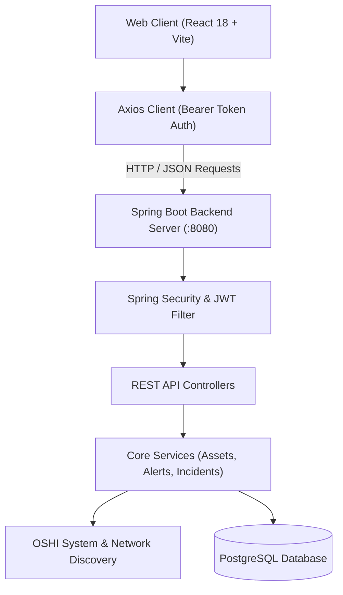

# 🛡️ SentinelCore SecureOps

<div align="center">

[](https://spring.io/projects/spring-boot)
[](https://react.dev/)
[](https://vitejs.dev/)
[](https://www.postgresql.org/)
[](https://jwt.io/)
[](LICENSE)

**A centralized Security Operations Center (SOC) and infrastructure monitoring platform for real-time asset tracking, automated network discovery, vulnerability assessment, and threat triage.**

[Overview](#-overview) • [System Flow](#-system-architecture--flow) • [Features](#-core-features) • [Tech Stack](#-technology-stack) • [Project Structure](#-project-structure) • [Setup Guide](#-setup--installation) • [API Endpoints](#-api-endpoints)

</div>

---

## 📌 Overview

**SentinelCore SecureOps** is an all-in-one security and infrastructure operations platform. It combines live system telemetry, automated subnet discovery, vulnerability scoring, and incident triage into a unified, cyber-themed interface.

Instead of managing separate tools for network auditing, device inventory, and performance monitoring, SentinelCore centralizes everything into an actionable operations command center.

---

## 🏗️ System Architecture & Flow

The diagram below outlines how user actions travel from the client interface through the security layers, business logic, system monitoring probes, and database storage:



---

## ✨ Core Features

* **Real-Time SOC Dashboard**: Live monitoring of CPU, RAM, disk usage, and network activity powered by OSHI hardware counters.
* **Automated Asset Discovery**: Periodic background network scanning to discover active devices and hostnames across configured subnets.
* **Multi-Instance Asset Tracking**: Seamlessly tracks multiple services, virtual machines, and containers sharing a single host IP.
* **Alert & Threat Triage**: Categorizes security threats into Critical, High, Medium, and Low priorities with real-time status updates.
* **Incident Management**: End-to-end incident tracking through defined stages: `New` ➔ `In Progress` ➔ `Mitigated` ➔ `Resolved`.
* **Vulnerability Catalog**: Catalogs Common Vulnerabilities and Exposures (CVEs) with CVSS hazard scores and remediation guidance.
* **Multi-Cloud Overview**: High-level health and instance posture checks across AWS, Azure, and GCP resources.
* **Export & Reporting Engine**: Generates formatted **PDF audit reports** and **Excel (.xlsx)** spreadsheets with a single click.
* **Role-Based Access Control (RBAC)**: Enforces role permissions for `ADMIN`, `ITSM`, and `USER` via stateless JWT authentication.

---

## 💻 Technology Stack

### Frontend
| Component | Technology | Description |
|---|---|---|
| Framework | **React 18** | Modular component-based frontend |
| Build Tool | **Vite 5** | Ultra-fast development and optimized builds |
| Routing | **React Router DOM v6** | Declarative page navigation and route protection |
| Styling | **Custom SOC Design System** | Cyber-themed dark mode styling with CSS variables |
| Visualizations | **Recharts** | Interactive line, area, and bar charts |
| Animations | **Framer Motion** | Smooth UI transitions and micro-interactions |
| Document Export | **jsPDF & XLSX** | Dynamic client-side PDF and Excel generation |

### Backend
| Component | Technology | Description |
|---|---|---|
| Language | **Java 17 (LTS)** | Core backend language |
| Framework | **Spring Boot 3.x** | Enterprise REST API backend |
| Security | **Spring Security 6 + JWT** | Stateless token authentication and role verification |
| Telemetry Engine | **OSHI** | Operating system and hardware metrics probing |
| ORM / Persistence | **Spring Data JPA** | Hibernate object-relational mapping |
| Database | **PostgreSQL 16** | Relational database storage |
| API Documentation | **SpringDoc Swagger** | Interactive endpoint documentation (`/swagger-ui.html`) |

---

## 📁 Project Structure

```
SentinelCore-SecueOps/
├── .env.example                     # Master environment variables template
├── .gitignore                       # Ignored files (secrets, database, build files)
├── README.md                        # Project documentation
│
├── Secops/                          # Backend Application (Spring Boot)
│   ├── .env.example                 # Backend environment variable template
│   ├── pom.xml                      # Maven project configuration
│   ├── src/
│   │   ├── main/
│   │   │   ├── java/com/internship/infosys/
│   │   │   │   ├── config/          # Security, CORS, and Swagger configs
│   │   │   │   ├── controller/      # API Endpoints (Auth, Assets, Alerts, etc.)
│   │   │   │   ├── dto/             # Request & Response Data Transfer Objects
│   │   │   │   ├── model/           # JPA Entities (Asset, User, Role, Profile)
│   │   │   │   ├── repositary/      # Database repositories
│   │   │   │   ├── scheduler/       # Scheduled discovery & scanning tasks
│   │   │   │   ├── security/        # JWT filter, token utilities, user details
│   │   │   │   └── service/         # Business logic implementation
│   │   │   └── resources/
│   │   │       └── application.properties # Parameterized backend settings
│   │   └── test/                    # Backend unit tests
│
└── my frontend/                     # Frontend Application (React + Vite)
    ├── .env.example                 # Frontend environment template
    ├── package.json                 # Node dependencies and scripts
    ├── vite.config.js               # Bundler settings
    ├── index.html                   # HTML entry point with design fonts
    └── src/
        ├── api/                     # Central Axios instance and API methods
        ├── assets/                  # Icons and images
        ├── components/              # Reusable UI elements (Navbar, Sidebar, Tables)
        ├── App.jsx                  # Main routing switch
        ├── main.jsx                 # React root mounting
        └── index.css                # Global cyber SOC theme styles
```

---

## 🚀 Setup & Installation

### Prerequisites
* **Java Development Kit (JDK) 17+**
* **Node.js 18+** & npm
* **PostgreSQL 15+**

---

### 1. Database Setup

Create the database in PostgreSQL using your terminal or pgAdmin:

```sql
CREATE DATABASE secureopsprojectes;
```

---

### 2. Backend Setup (Spring Boot)

1. Open a terminal and navigate to the backend directory:
   ```bash
   cd Secops
   ```

2. Run the application:
   ```bash
   # Windows
   ./mvnw.cmd spring-boot:run

   # Linux / macOS
   ./mvnw spring-boot:run
   ```

* Backend server runs at: **`http://localhost:8080`**
* Interactive Swagger API docs: **`http://localhost:8080/swagger-ui.html`**

---

### 3. Frontend Setup (React + Vite)

1. Open a second terminal and navigate to the frontend directory:
   ```bash
   cd "my frontend"
   ```

2. Install dependencies:
   ```bash
   npm install
   ```

3. Start the dev server:
   ```bash
   npm run dev
   ```

* Open your browser at: **`http://localhost:5173`**

---

## ⚙️ Environment Variables

Sensitive values and connection details are managed through environment variables with safe defaults:

| Variable | Scope | Default Value | Description |
|---|---|---|---|
| `SPRING_DATASOURCE_URL` | Backend | `jdbc:postgresql://localhost:5433/secureopsprojectes` | Database connection URL |
| `SPRING_DATASOURCE_USERNAME` | Backend | `postgres` | Database username |
| `SPRING_DATASOURCE_PASSWORD` | Backend | `root` | Database password |
| `JWT_SECRET` | Backend | *(256-bit secret key)* | Signing key for JWT tokens |
| `SERVER_PORT` | Backend | `8080` | Spring Boot port |
| `VITE_API_BASE_URL` | Frontend | `http://localhost:8080/api` | API backend URL for Axios |

Templates are provided in `.env.example` in both folders.

---

## 📡 API Endpoints

A quick overview of key REST endpoints:

| Method | Endpoint | Description | Access |
|---|---|---|---|
| `POST` | `/api/auth/login` | Authenticate and receive JWT token | Public |
| `POST` | `/api/auth/register` | Register a new user | Public |
| `GET` | `/api/dashboard/stats` | System telemetry and hardware stats | `USER`, `ITSM`, `ADMIN` |
| `GET` | `/api/assets` | Get all inventory assets | `ITSM`, `ADMIN` |
| `POST` | `/api/assets` | Register a new asset | `ITSM`, `ADMIN` |
| `DELETE`| `/api/assets/{id}` | Delete an asset | `ADMIN` |
| `GET` | `/api/alerts` | List all security alerts | `USER`, `ITSM`, `ADMIN` |
| `GET` | `/api/incidents` | List incident triage cases | `USER`, `ITSM`, `ADMIN` |
| `GET` | `/api/vulnerabilities`| List known CVE vulnerabilities | `ITSM`, `ADMIN` |
| `GET` | `/api/cloud` | Query multi-cloud resource health | `ITSM`, `ADMIN` |
| `GET` | `/api/users` | Manage registered accounts | `ADMIN` |

---

## 👥 Role Permissions

| Action | `ADMIN` | `ITSM` | `USER` |
|---|:---:|:---:|:---:|
| View Dashboard & Telemetry | ✅ | ✅ | ✅ |
| View Alerts & Incidents | ✅ | ✅ | ✅ |
| Manage Assets (Create / Edit) | ✅ | ✅ | ❌ |
| Delete Assets | ✅ | ❌ | ❌ |
| Manage Users & Roles | ✅ | ❌ | ❌ |
| Export Reports (PDF / Excel) | ✅ | ✅ | ❌ |

---

## 📄 License

This project was built collaboratively as a capstone security engineering project and is licensed under the [MIT License](LICENSE).
