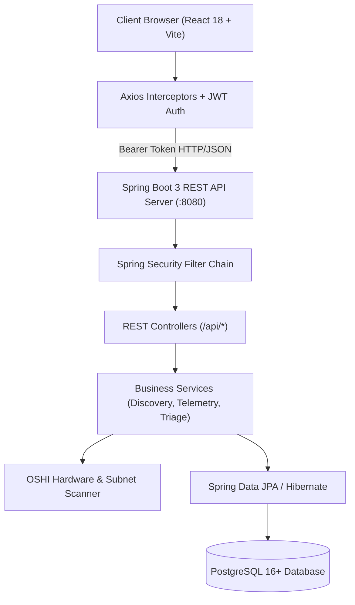

# 🛡️ SentinelCore SecureOps

<div align="center">

[](https://spring.io/projects/spring-boot)
[](https://react.dev/)
[](https://vitejs.dev/)
[](https://www.postgresql.org/)
[](https://jwt.io/)
[](LICENSE)

**An enterprise-grade Security Operations Center (SOC) and infrastructure monitoring platform designed for real-time asset discovery, threat monitoring, incident management, and cloud security governance.**

[Features](#-key-features) • [Architecture](#-architecture) • [Tech Stack](#-technology-stack) • [Quick Start](#-getting-started) • [Environment Setup](#-environment-variables) • [API Docs](#-api-endpoints)

</div>

---

## 📌 Executive Overview

**SentinelCore SecureOps** is a centralized security and infrastructure intelligence platform. It bridges the gap between raw hardware telemetry, network discovery, and security operations triage by offering real-time system monitoring, automated subnet scanning, CVE vulnerability scoring, and incident lifecycle management—packaged in a modern high-contrast SOC dashboard.

---

## ✨ Key Features

### 🖥️ Security Operations Center (SOC) Dashboard
* **Real-Time Telemetry**: Live CPU, memory, storage, and network throughput charts powered by **OSHI (Operating System and Hardware Information)**.
* **Threat & Health Metrics**: Instant visibility into healthy vs. critical assets, active alerts, and incident trends.
* **Interactive Visualizations**: High-performance telemetry charts built with **Recharts** and fluid UI transitions via **Framer Motion**.

### 🔍 IT Asset Discovery & Inventory
* **Automated Subnet Scanning**: Discovers live hosts, ports, and operating system signatures across configured IP ranges.
* **Multi-Tenant IP Handling**: Supports multiple virtualized or containerized assets mapped to shared physical host IPs.
* **Lifecycle Tracking**: Full CRUD management of servers, endpoints, databases, and network appliances.

### 🚨 Alert Monitoring & Threat Triage
* **Severity Levels**: Categorization across **Critical**, **High**, **Medium**, and **Low** risks with live pulse indicators.
* **Actionable Workflows**: Acknowledge, escalate, suppress, or resolve alerts with contextual telemetry.

### 🛡️ Incident Response Management
* **End-to-End Tracking**: Manage incidents through stages: `New` ➔ `In Progress` ➔ `Mitigated` ➔ `Resolved`.
* **Investigative Log**: Attach incident notes, forensic metadata, and assign handling to security analysts.

### ⚠️ Vulnerability Intelligence (CVE / CVSS)
* **CVE Tracking**: Catalog software packages, known vulnerabilities, and CVSS severity ratings.
* **Remediation Roadmaps**: Contextual patching guidance and vendor advisory links.

### ☁️ Multi-Cloud Resource Governance
* **Cloud Posture**: Monitor cloud workloads across AWS, Microsoft Azure, and Google Cloud Platform (GCP).
* **Compliance Checks**: Surface unencrypted storage buckets, public access misconfigurations, and inactive instances.

### 📊 Comprehensive Reports & Export Engine
* **Export Anywhere**: One-click export to branded **PDF** reports (with tabular formatting) and **Microsoft Excel (XLSX)** spreadsheets.
* **Audit Trails**: Export security summaries, asset health reports, and incident logs for compliance compliance (ISO 27001, SOC 2).

### 👥 Role-Based Access Control (RBAC)
* **Granular Roles**: Strict role enforcement (`ADMIN`, `ITSM`, `USER`) via Spring Security 6 and stateless JWT tokens.
* **Auditability**: User status controls, password reset workflows, and user session monitoring.

---

## 🏗️ Architecture



---

## 💻 Technology Stack

### Frontend
| Component | Technology | Description |
|---|---|---|
| Framework | **React 18** | High-performance reactive component tree |
| Build Tool | **Vite 5** | Lightning-fast HMR and optimized production bundling |
| Routing | **React Router DOM v6** | Declarative client-side routing & protected routes |
| State & Auth | **React Context API** | Global token management and session persistence |
| Styling | **Custom Cyber SOC CSS** | Enterprise dark theme, CSS variable design tokens |
| Visualizations | **Recharts** | Interactive SVG charts for metrics and historical logs |
| Animations | **Framer Motion** | Fluid card entries, transitions, and micro-interactions |
| Notifications | **React Toastify** | Toast notifications for async API actions |
| Reporting | **jsPDF & SheetJS (xlsx)** | Client-side dynamic PDF and Excel generator |
| Icons | **React Icons** | FontAwesome and Simple Icons integration |

### Backend
| Component | Technology | Description |
|---|---|---|
| Runtime | **Java 17+ (LTS)** | Modern Java platform |
| Framework | **Spring Boot 3.x** | Enterprise application core |
| Security | **Spring Security 6 + JWT** | Stateless token-based authentication and RBAC |
| Persistence | **Spring Data JPA / Hibernate** | Object-relational mapping and schema management |
| Telemetry | **OSHI** | Native OS and hardware discovery engine |
| Connection Pool | **HikariCP** | High-throughput database connection pooling |
| Documentation | **SpringDoc OpenAPI / Swagger** | Interactive API documentation (`/swagger-ui.html`) |
| Metrics | **Spring Boot Actuator** | Production health probes and endpoint diagnostics |

---

## 📁 Repository Structure

```
SentinelCore-SecueOps/
├── .env.example                     # Root environment configuration template
├── .gitignore                       # Master gitignore protecting secrets & build artifacts
├── README.md                        # Project documentation
│
├── Secops/                          # Backend Service (Spring Boot)
│   ├── .env.example                 # Backend environment variable template
│   ├── pom.xml                      # Maven project dependencies
│   ├── src/
│   │   ├── main/
│   │   │   ├── java/com/internship/infosys/
│   │   │   │   ├── controller/      # REST Endpoints (Auth, Assets, Alerts, etc.)
│   │   │   │   ├── entity/          # JPA Entities
│   │   │   │   ├── repository/      # Spring Data JPA Repositories
│   │   │   │   ├── service/         # Business Logic & OSHI Scanners
│   │   │   │   ├── security/        # JWT Filter, CustomUserDetailsService, SecurityConfig
│   │   │   │   └── config/          # CORS, Swagger, and App configurations
│   │   │   └── resources/
│   │   │       └── application.properties # Parameterized application settings
│   │   └── test/                    # Unit and integration test suites
│
└── my frontend/                     # Frontend Application (React + Vite)
    ├── .env.example                 # Frontend environment template
    ├── package.json                 # Node dependencies and build scripts
    ├── vite.config.js               # Vite bundler configuration
    ├── index.html                   # Entry HTML with critical CSS and Google Fonts
    └── src/
        ├── api/                     # Centralized Axios instance & API services
        ├── assets/                  # Static assets and icons
        ├── components/              # Reusable UI widgets (Navbar, Sidebar, Tables)
        ├── App.jsx                  # Main route switch
        ├── main.jsx                 # React root bootstrap & global CSS
        └── index.css                # Enterprise SOC design system & theme tokens
```

---

## 🚀 Getting Started

### Prerequisites
* **Java Development Kit (JDK)**: Version 17 or higher
* **Node.js**: Version 18.x or higher & npm
* **PostgreSQL**: Version 15 or higher
* **Git**: Installed and configured

---

### Step 1: Database Setup

1. Open PostgreSQL CLI (`psql`) or pgAdmin and create the database:
```sql
CREATE DATABASE secureopsprojectes;
```
2. Verify your PostgreSQL user credentials (default: username `postgres`, password `root` or as configured).

---

### Step 2: Backend Configuration & Launch

1. Navigate to the backend directory:
```bash
cd Secops
```

2. *(Optional)* Copy the environment file:
```bash
cp .env.example .env
```

3. Build and launch the Spring Boot application:
```bash
# On Windows:
./mvnw.cmd spring-boot:run

# On Linux/macOS:
./mvnw spring-boot:run
```

* The backend service will start on: **`http://localhost:8080`**
* Interactive Swagger API documentation: **`http://localhost:8080/swagger-ui.html`**

---

### Step 3: Frontend Configuration & Launch

1. In a new terminal, navigate to the frontend directory:
```bash
cd "my frontend"
```

2. *(Optional)* Copy the environment template:
```bash
cp .env.example .env
```

3. Install project dependencies:
```bash
npm install
```

4. Start the Vite development server:
```bash
npm run dev
```

* The web application will launch at: **`http://localhost:5173`**

---

## 🔐 Environment Variables

The project uses parameterized variables with secure defaults for effortless local development and production readiness:

### Backend (`Secops/.env` or system environment)
| Variable | Default Value | Description |
|---|---|---|
| `SPRING_DATASOURCE_URL` | `jdbc:postgresql://localhost:5433/secureopsprojectes` | PostgreSQL JDBC connection URL |
| `SPRING_DATASOURCE_USERNAME` | `postgres` | Database username |
| `SPRING_DATASOURCE_PASSWORD` | `root` | Database password |
| `JWT_SECRET` | *(256-bit secure key)* | Secret key used for signing JWT tokens |
| `JWT_EXPIRATION` | `86400000` (24h in ms) | JWT validity window |
| `SERVER_PORT` | `8080` | Spring Boot HTTP port |
| `SPRING_MAIL_USERNAME` | `your-email@gmail.com` | SMTP email address for alert emails |
| `SPRING_MAIL_PASSWORD` | `your-app-password` | SMTP App password |

### Frontend (`my frontend/.env`)
| Variable | Default Value | Description |
|---|---|---|
| `VITE_API_BASE_URL` | `http://localhost:8080/api` | Target Spring Boot REST API base endpoint |

> **Security Note**: Never commit `.env` files containing live credentials. Only commit `.env.example` templates.

---

## 📡 API Endpoints

A selection of key REST APIs available on `http://localhost:8080/api`:

| Method | Endpoint | Description | Role Required |
|---|---|---|---|
| `POST` | `/auth/login` | Authenticate user & issue JWT token | `PermitAll` |
| `POST` | `/auth/register` | Register a new user | `PermitAll` |
| `GET` | `/assets` | Retrieve all managed assets | `ADMIN`, `ITSM` |
| `POST` | `/assets` | Register a new IT asset | `ADMIN`, `ITSM` |
| `PUT` | `/assets/{id}` | Update existing asset specifications | `ADMIN`, `ITSM` |
| `DELETE` | `/assets/{id}` | Remove asset from inventory | `ADMIN` |
| `GET` | `/alerts` | Query active security alerts | `ADMIN`, `ITSM`, `USER` |
| `GET` | `/incidents` | List incident triage cases | `ADMIN`, `ITSM`, `USER` |
| `GET` | `/vulnerabilities`| Fetch active CVE vulnerabilities | `ADMIN`, `ITSM` |
| `GET` | `/cloud` | Retrieve multi-cloud resource health | `ADMIN`, `ITSM` |
| `GET` | `/users` | Manage registered accounts | `ADMIN` |

---

## 🛡️ Security Best Practices

* **Stateless Authentication**: Sessions are managed exclusively via HMAC-SHA256 signed JWT tokens stored securely on the client.
* **CORS Protection**: Access is restricted to designated frontend origins in `WebConfig.java`.
* **Zero Secret Leakage**: Database passwords, mail credentials, and cryptographic signing keys are completely decoupled from source code into environment-bound templates.
* **Password Hashing**: User credentials are encrypted at rest using industry-standard **BCrypt** with high work factor salts.

---

## 🤝 Contributing

1. Fork the Repository: `git fork`
2. Create your Feature Branch: `git checkout -b feature/SentinelFeature`
3. Commit your changes: `git commit -m 'feat: Add threat intelligence pipeline'`
4. Push to the Branch: `git push origin feature/SentinelFeature`
5. Open a Pull Request

---

## 📄 License

This project is licensed under the [MIT License](LICENSE).
