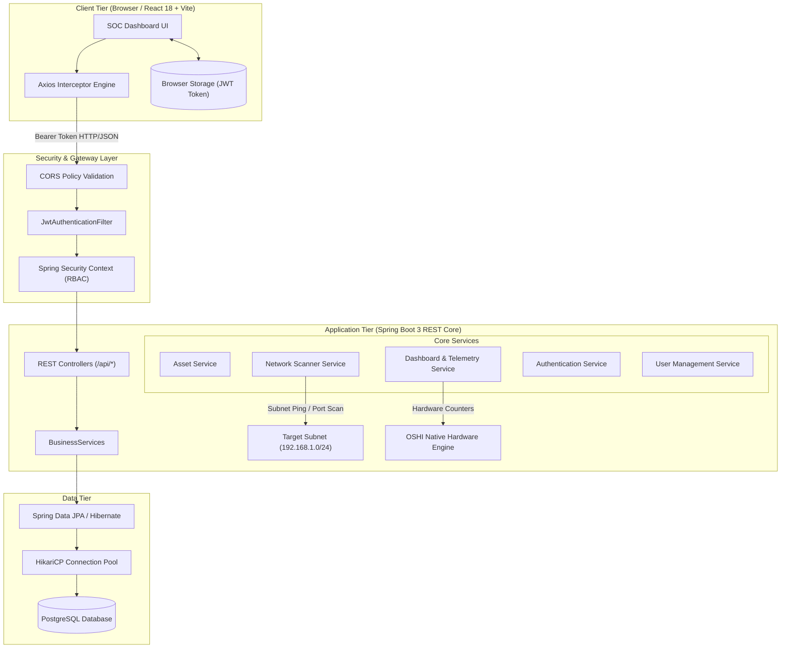
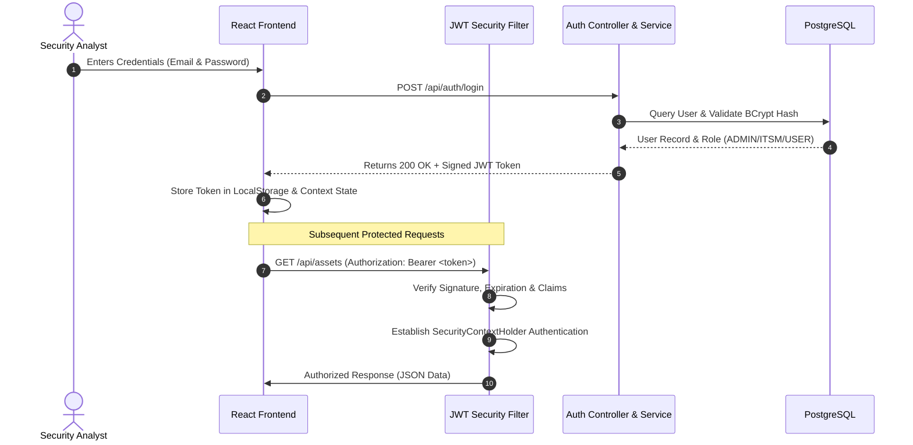
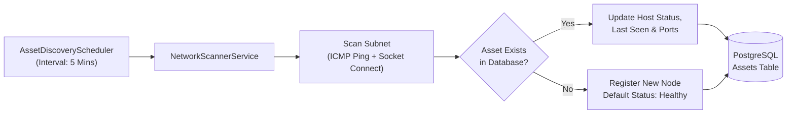

# 🛡️ SentinelCore SecureOps

<div align="center">

[](https://spring.io/projects/spring-boot)
[](https://react.dev/)
[](https://jwt.io/)
[](https://www.postgresql.org/)
[](LICENSE)

**An enterprise-grade Security Operations Center (SOC) and proactive infrastructure observability platform designed for automated network discovery, real-time hardware telemetry, security threat triage, and compliance auditing.**

[System Architecture](#-system-architecture) • [Data & Security Flows](#-data--security-workflows) • [Key Capabilities](#-core-capabilities) • [Tech Stack](#-technology-stack) • [Installation & Setup](#-deployment--setup-guide) • [API Directory](#-api-endpoints-reference)

</div>

---

## 📌 Platform Overview

Modern security teams struggle with fragmented tooling: device inventories reside in one system, real-time CPU/memory metrics in another, and CVE vulnerability scanners elsewhere. 

**SentinelCore SecureOps** solves this by unifying **host monitoring**, **network discovery**, **incident response**, and **cloud posture governance** into a single cohesive, high-contrast security dashboard. Built on a decoupled Spring Boot 3 REST core and a reactive Vite/React frontend, SentinelCore delivers sub-second telemetry insights, automated subnet scanning, and role-based incident workflows.

---

## 🏗️ System Architecture

The following diagram illustrates the multi-tier enterprise architecture of SentinelCore, tracing requests from the client presentation tier through security filtering, business orchestration, and persistence.



---

## 🔄 Data & Security Workflows

### 1. Authentication & Session Lifecycle

SentinelCore enforces stateless session management using signed HMAC-SHA256 JWT tokens.



### 2. Automated Asset Discovery Pipeline

SentinelCore automatically maps local subnets to track live infrastructure nodes without third-party agents.



---

## ✨ Core Capabilities

### 1. Unified SOC Command Center
* **Live System Diagnostics**: Real-time visualization of host CPU utilization, available RAM, disk IO, and network interfaces via **OSHI**.
* **High-Level Security Gauges**: Real-time counter widgets displaying total assets, active threats, open incidents, and network health.
* **Interactive Data Views**: Telemetry and time-series trend lines built with **Recharts**, accompanied by animated micro-interactions powered by **Framer Motion**.

### 2. Network & Hardware Inventory
* **Subnet Scanning Engine**: Configurable subnet traversal sweeps IP pools to register reachable workstations, servers, and switches.
* **Shared-IP Node Support**: Manages multi-instance environments, container clusters, and virtual machines bound to shared gateway addresses.
* **Granular Specifications**: Tracks operating system versions, MAC addresses, department affiliations, and lifecycle statuses (`Active`, `Inactive`, `Decommissioned`).

### 3. Alert Triage & Incident Workflow
* **Tiered Severity Matrix**: Real-time categorization of security events into **Critical**, **High**, **Medium**, and **Low** classifications.
* **Structured Incident Pipeline**: Drives containment actions through standard SOC phases: `New` ➔ `In Progress` ➔ `Mitigated` ➔ `Resolved`.
* **Investigative Audit Trail**: Analyst assignment, timestamped incident notes, and root-cause annotations.

### 4. Vulnerability Catalog & Multi-Cloud Observability
* **CVE Repository**: Track Common Vulnerabilities and Exposures (CVE) alongside industry CVSS hazard ratings and vendor workarounds.
* **Cloud Infrastructure Oversight**: Consolidated metrics for computing instances, security groups, and storage across **AWS**, **Microsoft Azure**, and **GCP**.

### 5. Automated Reporting & Export Engine
* **Single-Click Exports**: Generate clean, branded **PDF audit reports** with formatted tables or raw **Microsoft Excel (.xlsx)** spreadsheets for compliance reviews (SOC 2, ISO 27001).

---

## 💻 Technology Stack

### Frontend Architecture
| Layer | Technology | Details |
|---|---|---|
| Framework & Library | **React 18** | Functional component architecture with hooks |
| Build Tool | **Vite 5** | High-speed ESM compilation and hot-module reloading |
| Styling & Theme | **Custom SOC CSS Tokens** | Full cyber dark theme with CSS custom properties |
| Routing | **React Router DOM v6** | Declarative route protection and role-gated navigation |
| Charts & Graphics | **Recharts** | Hardware telemetry, area charts, and bar diagrams |
| Animation | **Framer Motion** | Physics-based layout transitions and card entries |
| Document Export | **jsPDF & SheetJS (xlsx)** | Client-side report compiling and spreadsheet exports |
| Notifications | **React Toastify** | Event toasts for API operations and session alerts |

### Backend Architecture
| Layer | Technology | Details |
|---|---|---|
| Core Runtime | **Java 17 (LTS)** | Modern Java features and memory performance |
| Framework | **Spring Boot 3.x** | Enterprise REST architecture |
| Security | **Spring Security 6 + JWT** | Stateless filter chains, token signing, BCrypt hashing |
| Telemetry Engine | **OSHI 6.x** | Native OS hardware and memory probing |
| ORM / Persistence | **Spring Data JPA / Hibernate** | Relational mapping, schema versioning, query indexing |
| Connection Pool | **HikariCP** | High-performance pooled database connections |
| API Documentation | **SpringDoc OpenAPI / Swagger** | Interactive Swagger-UI endpoint sandbox (`/swagger-ui.html`) |

---

## 🗂️ Project Directory Structure

```
SentinelCore-SecureOps/
├── .env.example                     # Unified template for all environment variables
├── .gitignore                       # Git exclusion rules for secrets, storage & artifacts
├── README.md                        # Master project documentation
│
├── Secops/                          # Backend Microservice (Spring Boot)
│   ├── .env.example                 # Backend environment variable template
│   ├── pom.xml                      # Maven dependencies (Spring Boot, OSHI, JWT, Postgres)
│   ├── src/
│   │   ├── main/
│   │   │   ├── java/com/internship/infosys/
│   │   │   │   ├── config/          # SecurityConfig, CORS policies, Swagger setup
│   │   │   │   ├── controller/      # REST API Controllers (Auth, Asset, Alert, User, etc.)
│   │   │   │   ├── dto/             # Request & Response Data Transfer Objects
│   │   │   │   ├── model/           # Hibernate Entities (Asset, User, Role, Profile)
│   │   │   │   ├── repositary/      # Spring Data JPA Repository Interfaces
│   │   │   │   ├── scheduler/       # Scheduled Network & Asset Discovery Scanners
│   │   │   │   ├── security/        # JwtUtil, JwtAuthenticationFilter, UserDetailsService
│   │   │   │   └── service/         # Service layer implementation
│   │   │   └── resources/
│   │   │       └── application.properties # Parameterized application configuration
│   │   └── test/                    # Backend test suites
│
└── my frontend/                     # Frontend Application (React + Vite)
    ├── .env.example                 # Frontend environment template
    ├── package.json                 # Node dependencies and scripts
    ├── vite.config.js               # Bundler settings
    ├── index.html                   # HTML entry point with critical font & background rules
    └── src/
        ├── api/                     # Axios instance with auth interceptor & export tools
        ├── assets/                  # Logos and vector icons
        ├── components/              # Sidebar, Navbar, Tables, SearchBar, Footer
        ├── App.jsx                  # Main router definitions
        ├── main.jsx                 # Bootstrap entry importing global stylesheets
        └── index.css                # Enterprise SOC design tokens and base styles
```

---

## 🚀 Deployment & Setup Guide

### Prerequisites
* **Java Development Kit (JDK)**: Version 17 or higher
* **Node.js**: Version 18.x or higher with npm
* **PostgreSQL**: Version 15 or higher running locally or remotely

---

### Step 1: Prepare Database

Log into PostgreSQL and create the primary database:

```sql
CREATE DATABASE secureopsprojectes;
```

---

### Step 2: Configure & Start Backend (Spring Boot)

1. Open a terminal and switch to the `Secops` directory:
   ```bash
   cd Secops
   ```

2. Configure environment credentials:
   * By default, the application runs on development settings (`localhost:5433` or `5432`).
   * To override credentials, copy `.env.example` to `.env` or set environment variables in your environment.

3. Compile and execute the application:
   ```bash
   # Windows
   ./mvnw.cmd spring-boot:run

   # Linux / macOS
   ./mvnw spring-boot:run
   ```

* Backend REST Service: **`http://localhost:8080`**
* Interactive Swagger API Documentation: **`http://localhost:8080/swagger-ui.html`**

---

### Step 3: Configure & Start Frontend (React + Vite)

1. Open a second terminal window and navigate to the frontend directory:
   ```bash
   cd "my frontend"
   ```

2. Install JavaScript packages:
   ```bash
   npm install
   ```

3. Launch the Vite local dev server:
   ```bash
   npm run dev
   ```

* Web UI: **`http://localhost:5173`**

---

## 🔐 Environment Variables

SentinelCore decouples all credentials from source code into environment-bound variables:

| Variable | Target Component | Default Value | Description |
|---|---|---|---|
| `SPRING_DATASOURCE_URL` | Backend | `jdbc:postgresql://localhost:5433/secureopsprojectes` | JDBC connection string |
| `SPRING_DATASOURCE_USERNAME` | Backend | `postgres` | PostgreSQL username |
| `SPRING_DATASOURCE_PASSWORD` | Backend | `root` | PostgreSQL password |
| `JWT_SECRET` | Backend | *(256-bit secret string)* | HMAC-SHA256 signature key |
| `JWT_EXPIRATION` | Backend | `86400000` (24 Hours) | Token lifetime in milliseconds |
| `SERVER_PORT` | Backend | `8080` | Spring Boot HTTP port |
| `VITE_API_BASE_URL` | Frontend | `http://localhost:8080/api` | Spring Boot API destination |

---

## 📡 API Endpoints Reference

A summary of core endpoints exposed by the SentinelCore API:

| HTTP Method | Route | Description | Minimum Access Role |
|---|---|---|---|
| `POST` | `/api/auth/login` | Authenticate and issue JWT Bearer token | `PermitAll` |
| `POST` | `/api/auth/register` | Register new user account | `PermitAll` |
| `GET` | `/api/dashboard/stats` | Retrieve aggregated telemetry & system counters | `USER` |
| `GET` | `/api/assets` | Retrieve list of all tracked network assets | `ITSM` |
| `POST` | `/api/assets` | Register a new asset manually | `ITSM` |
| `PUT` | `/api/assets/{id}` | Update existing asset specifications | `ITSM` |
| `DELETE`| `/api/assets/{id}` | Decommission and remove asset from inventory | `ADMIN` |
| `GET` | `/api/alerts` | Query active security alerts and severity levels | `USER` |
| `GET` | `/api/incidents` | Retrieve incident tickets and mitigation logs | `USER` |
| `GET` | `/api/vulnerabilities`| Catalog of CVE entries and CVSS hazard ratings | `ITSM` |
| `GET` | `/api/cloud` | Query multi-cloud resource health & postures | `ITSM` |
| `GET` | `/api/users` | List accounts, status, and role assignments | `ADMIN` |

---

## 👥 Role-Based Permission Matrix

SentinelCore implements an access control matrix to enforce principle of least privilege:

| Capability / Resource | Administrator (`ADMIN`) | Operations Analyst (`ITSM`) | Read-Only User (`USER`) |
|---|:---:|:---:|:---:|
| View SOC Dashboard & Telemetry | ✅ | ✅ | ✅ |
| View Alerts & Incidents | ✅ | ✅ | ✅ |
| Manage Asset Records (Create / Edit) | ✅ | ✅ | ❌ |
| Delete Assets | ✅ | ❌ | ❌ |
| Triage & Mitigate Incidents | ✅ | ✅ | ❌ |
| View Vulnerability & Cloud Portfolios | ✅ | ✅ | ❌ |
| User Administration & Role Assignment | ✅ | ❌ | ❌ |
| Generate Compliance Reports (PDF/Excel) | ✅ | ✅ | ❌ |

---

## 📄 License

This project was built collaboratively as a capstone security engineering project and is distributed under the terms of the [MIT License](LICENSE).
